# Voice Buddy

An inside-voice coach for kids, running on a $20 ESP32-S3 touchscreen. A friendly character listens through the built-in microphone and shows a child, without words or numbers, when their voice is getting too loud. Calm talking earns stars toward a daily goal. Nothing beeps or flashes.

Built for the **Freenove FNK0104B** (also sold as **LCDWIKI ES3C28P**): black ESP32-S3 2.8" ILI9341 board with capacitive touch, ES8311 audio codec + mic, and 8 MB PSRAM.

| Police pup | Too loud | Dial |
|---|---|---|
| 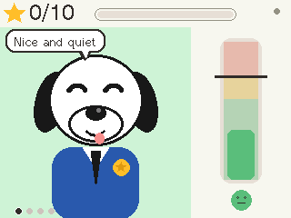 | 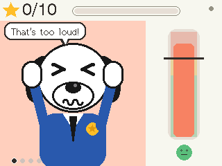 | 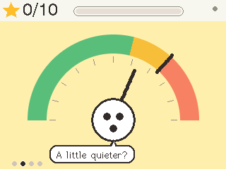 |
| **Saturn** | **Star earned** | **Solar system** |
| 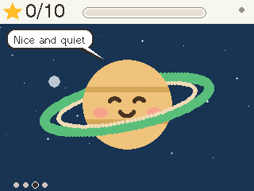 | 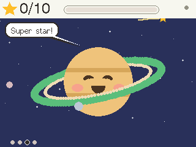 | 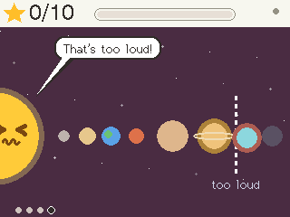 |

All screenshots are captured from the device itself (`tools/screenshot.py`).

## What it does

- **Four views, swipe to switch:** police pup, dial, Saturn, and a solar system where planets light up outward as the voice gets louder.
- **Voices only:** pitch detection ignores claps, bangs and fan noise, and a learned noise floor ignores steady background sound.
- **Stars** fill only while the child's voice is actually heard and under the line.
- **Speech bubbles** ("Nice and quiet", "That's too loud!", "Super star!").
- **Knows its own child's voice:** setup records the child and a grown-up, so adult voices can be ignored.
- **Distance aware:** WiFi CSI learns Near / Mid / Far zones in your room and lowers the line when the child is far away.
- **Louder room, higher line:** with the TV on, the line rises a little.

## First-time setup

Runs automatically on first boot (about 3 minutes), or from Settings › Setup:

1. Join your 2.4 GHz WiFi (on-screen keyboard)
2. 15 s of quiet to learn the room
3. Play near, mid-room and far away, 10 s each, to learn the zones
4. The child's inside voice (10 s), excited voice (6 s), and inside voice from far away
5. A grown-up's voice
6. Summary, then a live zone check

| Voice step | Zone check |
|---|---|
| 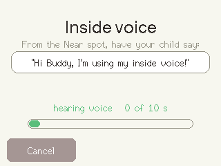 | 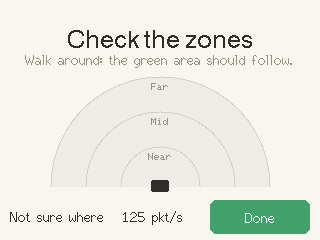 |

## Parent settings on the device

Hold the top-right corner for 3 seconds, then enter the PIN (default `1234`, change it under Screen). Five tabs, in plain language:

| Voice | Setup |
|---|---|
| 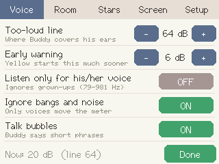 | 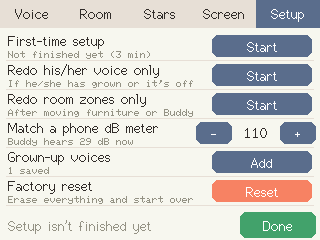 |

- **Voice:** too-loud line, early warning, listen only for his/her voice, ignore bangs and noise, talk bubbles
- **Room:** adjust for distance, live zone check, far-away adjustment, louder room higher line, WiFi & web control
- **Stars:** time per star, daily goal, loud empties the star bar, chime, reset
- **Screen:** brightness, LED glow, nap timer, start view, parent PIN
- **Setup:** first-time setup, redo voice or zones only, phone dB meter match, grown-up voices, **factory reset**

## Web control (optional)

Turn on **Settings › Room › WiFi & web control › Web control** and open `https://voicebuddy.local` (or scan the QR code on Buddy) from a phone or laptop on the same WiFi. Sign in with the parent PIN.

- Live voice level, today's stars, give a star, send a speech bubble, switch Buddy's screen, pause Buddy
- History (today's voice level and loud moments, stars per day for a week)
- All settings, plus a morning star reset and bedtime quiet hours
- Signed-in browsers, settings backup/restore, restart, firmware updates

| Sign in | Home | Settings |
|---|---|---|
| 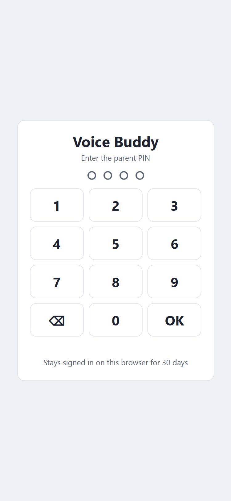 | 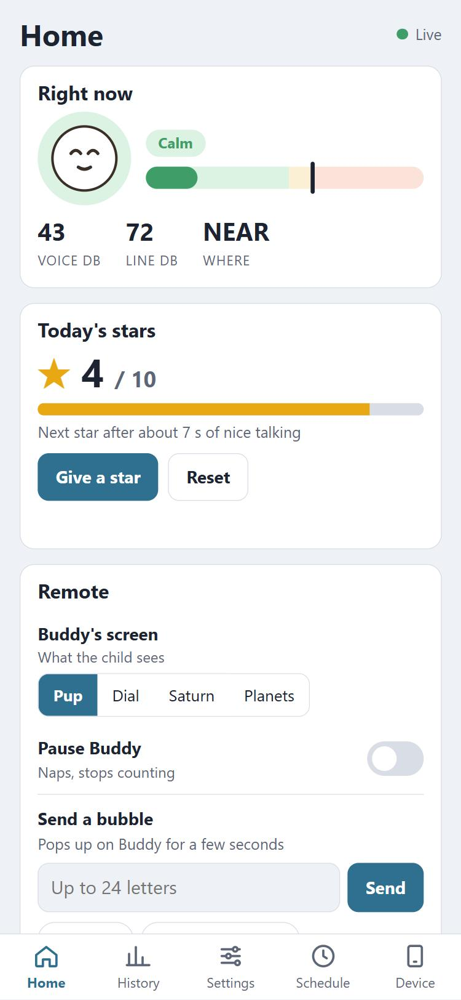 | 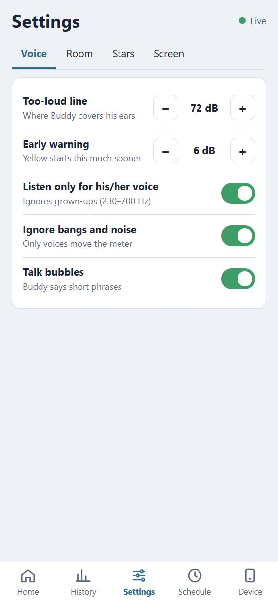 |

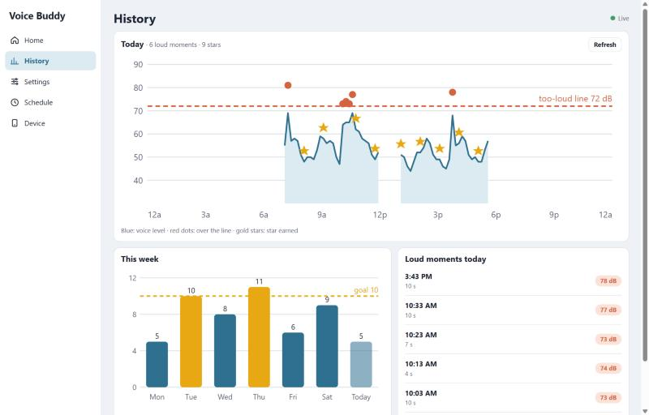

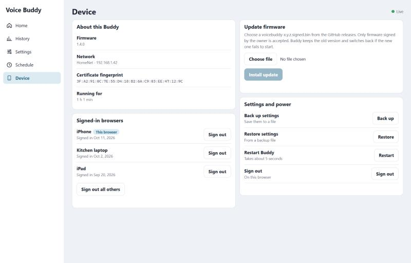

Web screenshots use the page's built-in demo data (open `web/index.html#demo` in any browser to try it).

**Security:** HTTPS only, with a certificate Buddy creates for itself on first use. The browser warns once because no public authority vouches for it: check that the fingerprint matches the one on Buddy's QR screen. Sessions last 30 days, 5 wrong PINs lock sign-in for 5 minutes, and Buddy shows a notice whenever a new browser signs in. Web control is off by default, and Buddy works the same without it.

## Firmware updates over WiFi (signed)

Buddy only installs updates signed with the owner's key, and keeps the old version in the other app slot. A new version has to run healthily for 30 seconds or the bootloader switches back.

```
python tools/keygen.py          # once: keys/signing_key.pem (keep it private + backed up)
pio run
python tools/sign_firmware.py   # -> bin/voicebuddy-<version>.signed.bin
```

Then upload the `.signed.bin` on the web page under Device › Update firmware. The public key in `src/signing_pubkey.h` is compiled into the firmware. If you build your own copy, run `keygen.py --force` to use your own key, then flash once over USB.

Flash layout (16 MB): nvs 20 KB · otadata · app0 6.25 MB · app1 6.25 MB · storage 3.4 MB (certificate, sessions, history) · coredump.

## Flash it

**Easiest:** flash [`bin/voicebuddy-es3c28p.bin`](bin/voicebuddy-es3c28p.bin) at address **0x0**, for example with [ESP Web Flasher](https://esptool.spacehuhn.com/), or:

```
esptool.py --chip esp32s3 write_flash 0x0 bin/voicebuddy-es3c28p.bin
```

**Start over:** Settings › Setup › Factory reset erases settings, WiFi, voices, zones, history and the web certificate, then restarts into first-time setup.

**From source** ([PlatformIO](https://platformio.org/)):

```
pio run -t erase
pio run -t upload
python tools/make_bin.py        # rebuild the 0x0 image
```

## Hardware notes

| Part | Pins |
|---|---|
| Display ILI9341 (FSPI) | MOSI 11, SCLK 12, MISO 13, CS 10, DC 46, backlight 45 |
| Touch FT6336G (I2C 0x38) | SDA 16, SCL 15, RST 18 |
| Audio codec ES8311 (I2C 0x18) | same I2C bus as touch |
| Audio I2S | MCLK 4, BCLK 5, LRCK 7, **mic data in 6**, speaker out 8, amp enable 1 |
| RGB LED WS2812B | 42 |

The mic data line is **IO6**, the reverse of what the board's BSP docs list. With IO8 as input the mic reads only zeros.

Core 0 runs audio and pitch detection plus CSI sensing; Core 1 only draws. Screen sprites live in PSRAM.

## Serial commands (115200)

`d` codec register dump · `S<view><mood>` force a screen · `W<mode>` open a setup step · `T<tab>` open a settings tab · `E1`/`E0` web control on/off · `P` dump the screen · `X` back to normal
